# OpenQPEP Full-Ecosystem Master Update Roadmap: Official Release `v1.0.2` → Official Release `v2.0.0`

**Organization:** Calyx Labs Inc. (Cleveland, Ohio)  
**Founder & Lead Architect:** Tristen Martinez (aka Calyxia)  
**Scope:** Complete synchronized evolution of **both** `/home/ubuntu/OpenQPEP/OpenQPEPSuite` (**219 files**: Core Protocol, Calyx QPEP Client, Calyx Encrypted Email, Calyx Encrypted Messenger, Docs, CI) **and** `/home/ubuntu/OpenQPEP/OpenQPEP_ServerFiles` (**154 files**: `Directory_Server`, `Messenger_Server`, `CalyxMail_Backend`, `CalyxMail_Frontend`, `Website_Server`, `GitHub_Mirror`)  
**Starting Baseline:** Official Stable Public Release **`v1.0.2`** → **Current Applied Release:** **`v1.1.0`** (`OpenQPEP/1.0.2`, Wire Format v5 `\x89QPE\x05\x00` / Compact TLV v5.1 `\x89QPE\x05\x01`, Stream v5 `\x89QPS\x05\x00`, Mandatory `kdf_version: 4`, CMT-4 Key-Committing `CC-512`)  
**Target Horizon:** Official Stable Public Release **`v2.0.0`** — The Worldwide Post-Quantum Standard Replacing OpenPGP  

---

> [!IMPORTANT]
> **Stable Public Release Compatibility Governance (`v1.0.2` → `v1.9.x` → `v2.0.0`)**
> Because OpenQPEP is now in **Official Stable Public Release**, all incremental releases from **`v1.1.0` through `v1.8.0`** strictly preserve **100% backwards compatibility with all `v1.0.0`–`v1.0.2` public Wire Format v5 (`\x89QPE\x05\x00` / `\x89QPE\x05\x01`), Stream v5 (`\x89QPS\x05\x00`), and `kdf_version: 4` key rings and packets**, while continuing to hard-reject all retired pre-release (`-rc`, `-pc`, `-beta`) formats with `QPEPLegacyProtocolError`. Breaking next-generation framing (**Wire Format v6 `\x89QPE\x06\x00`**) is reserved exclusively for **`v2.0.0`** with a clean, governed `v1.x → v2.0.0` migration bridge.

---

## 1. Deep Technical Audit of Current `v1.0.2` Ecosystem Baseline

A complete line-by-line scan of both `OpenQPEPSuite` and `OpenQPEP_ServerFiles` identified the exact engineering baseline, live defects, cryptographic gaps, and architectural ceilings at `v1.0.2` that directly drive our roadmap:

### 1.1 Verified Live Bugs & Broken Endpoints at `v1.0.2`

| Component | Exact File & Location | Verified Finding at `v1.0.2` |
| :--- | :--- | :--- |
| **Website Server** | [server.py](file:///home/ubuntu/OpenQPEP/OpenQPEP_ServerFiles/Website_Server/server.py#L118-L159) | **3 live HTTP bugs:** (1) `/api/v1/releases/latest` writes headers and JSON body **without calling `send_response(200)` or `end_headers()`** (produces corrupt HTTP); (2) the `410 Gone` pre-release download blocker calls `_send_security_headers()` **before** `send_response(410)`; (3) `/api/health` still reports `"wire_format": "v4 (\x89QPE\x04\x00)"`. |
| **Messenger Server** | [server.py](file:///home/ubuntu/OpenQPEP/OpenQPEP_ServerFiles/Messenger_Server/server.py#L945-L954) | **Broken `/api/v1/messages/burn` endpoint:** References undefined variable `payload` (instead of `body`), non-existent `self.server.db_path`, and wrong table/column `messages.id` (actual schema is `qpep_messages.message_id`), with zero sender/recipient ownership checks. |
| **All 3 App WebViews** | [index.html (Mail)](file:///home/ubuntu/OpenQPEP/OpenQPEP_ServerFiles/CalyxMail_Backend/static/index.html#L2150-L2236), [index.html (Messenger)](file:///home/ubuntu/OpenQPEP/OpenQPEP_ServerFiles/Messenger_Server/static/index.html#L4550-L4591), [calyx_qpep_app.html](file:///home/ubuntu/OpenQPEP/OpenQPEPSuite/apps/calyx-qpep-client/android/source/app/src/main/assets/calyx_qpep_app.html#L4720-L4732) | **`detectDeviceRamInfo()` duplicated 10–15× consecutively** inside all 3 HTML apps; Messenger and QPEP Client still contain trailing `v1.0.0-rc` blocks setting `window.OPENQPEP_WIRE_FORMAT = "v4 ..."` and `window.OPENQPEP_KDF_VERSION = 3`. |
| **Android Native Bridges** | [MainActivity.java (Client)](file:///home/ubuntu/OpenQPEP/OpenQPEPSuite/apps/calyx-qpep-client/android/source/app/src/main/java/com/calyxlabs/qpepclient/MainActivity.java#L31-L38), [MainActivity.java (Mail)](file:///home/ubuntu/OpenQPEP/OpenQPEPSuite/apps/calyx-encrypted-email/android/source/app/src/main/java/com/calyxlabs/mail/MainActivity.java#L173-L180), [MainActivity.java (Messenger)](file:///home/ubuntu/OpenQPEP/OpenQPEPSuite/apps/calyx-encrypted-messenger/android/source/app/src/main/java/com/calyxlabs/qpem/MainActivity.java#L168-L174) | All 3 JS apps probe `window.CalyxHardwareBridge.getDeviceRamGiB()`, yet all 3 `MainActivity.java` files define `private double getDeviceRamGiB()` and **never register `@JavascriptInterface`** with `wv.addJavascriptInterface(...)`. Also `build.gradle` files still say `1.0.0` while `AndroidManifest.xml` says `1.0.2`. |
| **QPEP Client iOS Drift** | [calyx_qpep_app.html](file:///home/ubuntu/OpenQPEP/OpenQPEPSuite/apps/calyx-qpep-client/android/source/app/src/main/assets/calyx_qpep_app.html) vs [qpep-client-ios.html](file:///home/ubuntu/OpenQPEP/OpenQPEPSuite/apps/calyx-qpep-client/ios/qpep-client-ios.html) | Android (`233,845 B`) and iOS (`234,302 B`) client HTML payloads have drifted out of sync. |
| **Failing Server Test Suites** | [test_calyxmail.py](file:///home/ubuntu/OpenQPEP/OpenQPEP_ServerFiles/CalyxMail_Backend/test_calyxmail.py), [test_messenger.py](file:///home/ubuntu/OpenQPEP/OpenQPEP_ServerFiles/Messenger_Server/test_messenger.py), [test_directory.py](file:///home/ubuntu/OpenQPEP/OpenQPEP_ServerFiles/Directory_Server/test_directory.py) | All 3 backend test suites currently exit non-zero (`rc=1`) at `v1.0.2` due to stale `1.0.0`/`v4` assertions, moved `CalyxMail_Backend` relative paths, and missing Wire v5 32-byte MAC in `test_directory.py`. |
| **Stale Pre-Release Metadata** | [README.md (Suite)](file:///home/ubuntu/OpenQPEP/OpenQPEPSuite/README.md), [CHANGELOG.md (Suite)](file:///home/ubuntu/OpenQPEP/OpenQPEPSuite/CHANGELOG.md), [index.html (Website)](file:///home/ubuntu/OpenQPEP/OpenQPEP_ServerFiles/Website_Server/index.html#L119), [app.py (Directory)](file:///home/ubuntu/OpenQPEP/OpenQPEP_ServerFiles/Directory_Server/app.py#L272-L459), `systemd/*.service` | Suite `README.md` & `CHANGELOG.md` still state `Production Candidate 1.2.0` / `Wire v3` / `kdf_version: 2`; Website hero strip says `OpenQPEP RC 1.0`; Directory HTML/errors say `Wire Format v5 (\x89QPE\x04\x00)`; Messenger `systemd` units say `PC 1.0.0`. |

### 1.2 Verified Cryptographic & Security Architecture Gaps at `v1.0.2`

> [!CAUTION]
> **Critical Security Gaps Requiring Immediate Remediation in `v1.1.0`–`v1.3.0`**
> 1. **Plaintext Stubs in Client JS Helpers:** In `calyx_qpep_app.html`, `DeniableVaultEngine.sealDualVolume` stores Base64 plaintext (`btoa(...)`) and `ThresholdKEMEngine.splitShards` copies the raw `secretHex` into every shard! In `calyx_mail.html`, `StreamingAttachmentEngine.uploadMultiRecipientStream` uploads unencrypted raw chunks (`uint8ToBase64(slice)`) with random dummy CEKs. In `calyx_v8.html`, `computeSafetyNumberV100` uses a non-cryptographic 32-bit FNV-1a hash.
> 2. **Backend Crypto Divergence:** `CalyxMail_Backend/calyx_qpep.py` and `Messenger_Server/calyx_qpep.py` are diverged 1,590-line standalone files using custom `qsponge_xof` XOR streams instead of the canonical `protocol/calyx_qpep` package's genuine **CMT-4 `AES-256-GCM` + `ChaCha20-Poly1305` `CC-512` AEAD** and **RFC 9106 `argon2-cffi` `QPKD-Argon2id`**.
> 3. **Directory Server Hardcoded Symmetric STH Secret:** `Directory_Server/app.py` signs Signed Tree Heads with a hardcoded fallback secret (`CALYX-QPEP-KT-STH-AUTHORITY-1.0.0`) instead of `protocol/calyx_qpep/directory_kt/merkle_log.py`'s publicly verifiable **Ed448 asymmetric STH** and lacks RFC 9162 **Merkle Consistency Proofs**.
> 4. **Unauthenticated Messenger Endpoints & Zero Server Rate Limiting:** `Messenger_Server/server.py` lacks cryptographic request authentication on `/api/v1/messages/inbox`, `/api/v1/messages/send`, `/api/v1/messages/burn`, and `/api/v1/profile/update`, and none of the 4 production servers enforce per-IP/per-key rate limiting.
> 5. **Stub Native WASM / Rust / Tauri Desktop Shells:** `openqpep_wasm.wasm` is a 115-byte stub, `rust/openqpep-core` is 89 lines (`ntt` + magic checks only), and all 3 `desktop/` directories lack a `src/main.rs` Tauri backend.

---

## 2. Ecosystem Evolution Architecture (`v1.0.2` → `v2.0.0`)

```mermaid
flowchart LR
  V102["v1.0.2 Baseline<br/>(Current Public Release)"]
  V110["v1.1.0<br/>Stabilization, Bug Fixes<br/>& Cryptographic Parity"]
  V120["v1.2.0<br/>Signed Auth, Real-Time SSE<br/>& 2FA Zero-Knowledge"]
  V130["v1.3.0<br/>Unified Native/WASM/Rust<br/>Crypto Core & Tauri Desktop"]
  V140["v1.4.0<br/>Federated OpenQPEP-MIME,<br/>SPF/DKIM/DMARC & Calendar"]
  V150["v1.5.0<br/>QPEP-SRTP Calls, MLS UI,<br/>LT-QR Airgap & CRDT Sync"]
  V160["v1.6.0<br/>Hardware Keys, StrongBox<br/>& Git/Supply-Chain Signing"]
  V170["v1.7.0<br/>Multi-Witness KT Gossip,<br/>Sphinx-PQ & Beyond-LWE SIMD"]
  V180["v1.8.0<br/>Formal Verification, Fuzzing<br/>& HA Zero-Downtime Ops"]
  V200["v2.0.0 Official Release<br/>Wire v6, Threshold-QVS,<br/>ZKP Credentials & Mesh"]

  V102 --> V110 --> V120 --> V130 --> V140 --> V150 --> V160 --> V170 --> V180 --> V200
```

Every incremental release updates **all 7 pillars of the ecosystem simultaneously**:
1. **Core Protocol** (`OpenQPEPSuite/protocol/`)
2. **Calyx QPEP Client** (`OpenQPEPSuite/apps/calyx-qpep-client/` — Android, iOS, Desktop)
3. **Calyx Encrypted Email** (`OpenQPEPSuite/apps/calyx-encrypted-email/` + `CalyxMail_Backend` + `CalyxMail_Frontend`)
4. **Calyx Encrypted Messenger** (`OpenQPEPSuite/apps/calyx-encrypted-messenger/` + `Messenger_Server`)
5. **OpenQPEP Key Directory** (`Directory_Server` — `qpepkeys.calyxlabsinc.org`)
6. **Official Website & GitHub Mirror** (`Website_Server` — `calyxlabsinc.org` + `GitHub_Mirror` — `calyxlabsinc.github.io`)
7. **Suite Docs, Packaging & CI/CD** (`OpenQPEPSuite/{README,CHANGELOG,ci.yml}`, `SHA256SUMS.txt`, unified tests)

---

## 3. Detailed Incremental Release Roadmap (`v1.1.0` → `v2.0.0`)

---

### Incremental Update 1: Official Release `v1.1.0` — Full-Ecosystem Stabilization, Critical Bug & Crypto-Stub Remediation, and Unified Parity

> [!TIP]
> **First Incremental Release — Ready to Apply Immediately Upon Your Approval.**
> Eliminates 100% of live bugs, plaintext client stubs, duplicated scripts, version drift, and failing test suites discovered in the `v1.0.2` audit so the entire ecosystem rests on a spotless, verified foundation.

| Ecosystem Pillar | Concrete `v1.1.0` Deliverables |
| :--- | :--- |
| **1. Core Protocol (`protocol/`)** | • Bump `UNIVERSAL_VERSION = "1.1.0"`, `PROTOCOL_VERSION = "OpenQPEP/1.1.0"`, `pyproject.toml`, `rust/openqpep-core/Cargo.toml`, and `go/openqpep` while maintaining **100% Wire Format v5 (`\x89QPE\x05\x00` / `\x89QPE\x05\x01`) & Stream v5 (`\x89QPS\x05\x00`) & `kdf_version: 4` compatibility** with `v1.0.0`–`v1.0.2` (updating `wire/framing.py` & `protocol.py` so `OpenQPEP/1.0.x` and `OpenQPEP/1.1.x` interoperate seamlessly while still rejecting all `-rc`, `-pc`, `-beta` with `QPEPLegacyProtocolError`). • Add `calyx_qpep.compat_server` shared server helper adapter for consistent Wire v5 MAC, CMT-4, and `.qpkrf` verification across all backend services. • Optimize test harness Argon2id / CSIDH timing fixtures so `python3 -m unittest discover -s tests` completes cleanly in `<25s`, and verify C99 `libopenqpep` builds with `-Wall -Wextra -Werror` + 10/10 KATs passing. |
| **2. Calyx QPEP Client (`apps/calyx-qpep-client`)** | • **Remediate Plaintext Stubs in `calyx_qpep_app.html`:** Replace `DeniableVaultEngine.sealDualVolume` with real dual-slot authenticated encryption (`WebCrypto AES-256-GCM` + `PBKDF2`/`qSponge` independent volume keys + indistinguishable random padding) and replace `ThresholdKEMEngine.splitShards` with genuine $\text{GF}(256)$ **Shamir Secret Sharing** (polynomial evaluation + Lagrange interpolation `reconstructSecret`). • Deduplicate the 15× repeated `detectDeviceRamInfo()` blocks and remove trailing stale `v4`/`kdf_version: 3` assignments. • Synchronize `android/.../calyx_qpep_app.html` and `ios/qpep-client-ios.html` to 100% byte-for-byte parity. • Register `@JavascriptInterface CalyxHardwareBridge.getDeviceRamGiB()` in `MainActivity.java`; bump `build.gradle.kts`, `AndroidManifest.xml` (`vc229`, `"1.1.0"`), Desktop `Cargo.toml`/`tauri.conf.json` (`1.1.0`), rebuild & re-sign `CalyxQPEPClient.apk` and `CalyxQPEPClient.mobileconfig`. |
| **3. Calyx Encrypted Email (`apps/calyx-encrypted-email` + `CalyxMail_Backend` + `CalyxMail_Frontend`)** | • **Fix Plaintext Attachment Uploads:** Upgrade `StreamingAttachmentEngine` in `CalyxMail_Backend/static/index.html` and Android `calyx_mail.html` so every 64 KiB chunk is encrypted client-side with a fresh 256-bit CEK (`WebCrypto AES-256-GCM` + Stream v5 `\x89QPS\x05\x00` framing + Merkle root over ciphertexts) and wrapped per recipient. • Strip the 15× duplicated `detectDeviceRamInfo()` blocks. • Upgrade `CalyxMail_Backend/calyx_qpep.py` symmetric layer to real **CMT-4 `AES-256-GCM` + `ChaCha20-Poly1305` `CC-512` AEAD** + `argon2-cffi` RFC 9106 `QPKD-Argon2id` (matching `protocol/calyx_qpep`). • Add sliding-window rate limiting to `api_server.py` (`/api/v1/auth/*`, `/api/v1/messages/send`), update `SERVER_HEADER` to `1.1.0`, expose `@JavascriptInterface CalyxHardwareBridge` in `MainActivity.java`, update `CalyxMail_Frontend` (`server.py`, `index.html`, downloads, `SHA256SUMS.txt`) to `1.1.0`, fix `test_calyxmail.py` paths & assertions to 100% pass, and rebuild/re-sign `CalyxEncryptedEmail.apk` (`vc11`, `"1.1.0"`) & `.mobileconfig`. |
| **4. Calyx Encrypted Messenger (`apps/calyx-encrypted-messenger` + `Messenger_Server`)** | • **Fix Broken `/api/v1/messages/burn` Endpoint** in `Messenger_Server/server.py` (fix `payload`→`body`, proper `db.burn_message(message_id, requester_key_hash)` deleting from `qpep_messages` with ownership check). • **Fix Non-Cryptographic Safety Number & Stale Variables** in `Messenger_Server/static/index.html` and Android `calyx_v8.html`: replace 32-bit FNV-1a in `computeSafetyNumberV100` with 512-bit `qSponge512Hex` / SHA-512, strip the 15× duplicated `detectDeviceRamInfo()` blocks, remove stale `v4`/`kdf_version: 3` assignments. • Upgrade `Messenger_Server/calyx_qpep.py` to real **CMT-4 `AES-256-GCM` + `ChaCha20-Poly1305` `CC-512`** + `argon2-cffi` `QPKD-Argon2id`; add rate limiting to `server.py`; update `systemd/*.service` from `PC 1.0.0` to `Official Release 1.1.0`. • Expose `@JavascriptInterface CalyxHardwareBridge` in `MainActivity.java`; update `build.gradle`/`AndroidManifest.xml` (`vc27`, `"1.1.0"`), Desktop `Cargo.toml`/`tauri.conf.json`; update `test_messenger.py` (including burn-message & CMT-4 tests) to 100% pass; rebuild & re-sign `CalyxEncryptedMessenger.apk` and `.mobileconfig`. |
| **5. Key Directory (`Directory_Server`)** | • **Eliminate Hardcoded Symmetric STH Secret:** Upgrade `Directory_Server/app.py` to persistent **Ed448 asymmetric Signed Tree Heads** (auto-generated `0600` PEM in `QPEP_KT_KEY_PATH` / data dir, publishing `sth_public_key_hex` in `/api/v1/kt/sth` and `/api/v1/health`). • **Add RFC 9162 Merkle Consistency Proofs:** Implement `GET /api/v1/kt/consistency?first=<n>&second=<m>` and add interactive consistency-proof verification to `/kt-audit`. • Fix stale `\x89QPE\x04\x00` copy/errors to `\x89QPE\x05\x00`; add per-IP rate limiting on `/api/v1/keys*`; update `test_directory.py` to verify real Wire v5 MACs, Ed448 STH signatures, and consistency proofs (100% pass). |
| **6. Website & GitHub Mirror (`Website_Server` + `GitHub_Mirror`)** | • **Fix Live HTTP Bugs in `Website_Server/server.py` (and mirror to `app.py`):** Add missing `send_response(200)` & `end_headers()` on `/api/v1/releases/latest`, fix header ordering on `410 Gone` pre-release rejections, and fix `/api/health` `"wire_format"` from `v4` to `v5 (\x89QPE\x05\x00 / \x89QPE\x05\x01)`. • Fix `"OpenQPEP RC 1.0"` on `index.html`, update all HTML pages (`index.html`, `openqpep.html`, `messenger.html`, `about.html`, `privacy.html`, `contact.html`) and `GitHub_Mirror` to **Official Release `v1.1.0`**. • Sync all 6 rebuilt `v1.1.0` APKs & `.mobileconfig` profiles into `Website_Server/downloads/`, `GitHub_Mirror/downloads/`, and `CalyxMail_Frontend/downloads/`, regenerate `SHA256SUMS.txt`, and add automated `Website_Server/test_website.py` verifying every route, HTTP header, `/api/health`, `/api/v1/releases/latest`, and `410 Gone` rule! |
| **7. Suite Docs & CI (`OpenQPEPSuite/`)** | • Rewrite stale `OpenQPEPSuite/README.md` and `OpenQPEPSuite/CHANGELOG.md` from `PC 1.2.0` / `Wire v3` to **Official Release `v1.1.0`**. • Add a unified root verification script & update `.github/workflows/ci.yml` to run C99 build, 10/10 KATs, protocol tests, and app manifest/icon/APK consistency checks. |

**`v1.1.0` Verification Gate:** `10/10` Protocol KATs pass + `100%` protocol unit tests pass (`<30s`) + `test_calyxmail.py` `100%` pass + `test_messenger.py` `100%` pass + `test_directory.py` `100%` pass + `test_website.py` `100%` pass + zero `detectDeviceRamInfo()` duplicates + zero stale `PC 1.2.0`/`RC 1.0.0`/`Wire v4` strings in active UIs.

---

### Incremental Update 2: Official Release `v1.2.0` — Cryptographic Request Authentication (`OpenQPEP-Auth-v1`), Real-Time Push Streaming (SSE / IMAP IDLE) & Zero-Knowledge 2FA

| Ecosystem Pillar | Concrete `v1.2.0` Deliverables |
| :--- | :--- |
| **1. Core Protocol (`protocol/`)** | • Specify & implement **`OpenQPEP-Auth-v1`** (`calyx_qpep.auth`): stateless cryptographic HTTP request authentication signing `METHOD|PATH|UTC_EPOCH|NONCE|SHA3_256(BODY)` with the user's Ed448/QVS identity key + 60s sliding nonce replay cache. • Add **$O(1)$-RAM Unix Streaming Pipes** to CLI: `openqpep encrypt --stream` and `openqpep decrypt --stream` reading/writing Stream v5 (`\x89QPS\x05\x00`) over `stdin`/`stdout`. |
| **2. Calyx QPEP Client** | • Add interactive **`QPEP-KT` Ed448 STH & RFC 9162 Consistency Proof Verifier** tab (fetches `/api/v1/kt/sth` + `/api/v1/kt/consistency`, caches previous STHs in IndexedDB, and raises a red **Split-View Equivocation Alert** if the directory ever rewrites history!). • Add **WebAuthn `FIDO2-PRF` Passkey Enrollment & Hardware Unlock** UI flow + encrypted full-keyring `.qbag` archive export/import. |
| **3. Calyx Encrypted Email** | • **Real-Time Inbox Push (`GET /api/v1/events/stream`):** Zero-polling Server-Sent Events (SSE) stream pushing new mail, read-flag changes, and TTL burn events instantly to Web, Android, iOS, and Desktop. • **RFC 2177 `IMAP IDLE` & RFC 6851 `MOVE`** support in `CalyxMail_Backend/imap_server.py`. • **Optional TOTP (RFC 6238) + WebAuthn Passkey 2FA** for `@calyxmail.org` login (`/api/v1/auth/2fa/*`) and **Encrypted Contacts Sync** (`/api/v1/contacts`, sealed client-side with user's own `.qpkrf`). |
| **4. Calyx Encrypted Messenger** | • **Mandatory `OpenQPEP-Auth-v1` Signed Request Auth** across `/api/v1/messages/inbox`, `/api/v1/messages/send`, `/api/v1/messages/burn`, `/api/v1/profile/update`, and `/api/v1/groups/*` — closing unauthenticated inbox/profile access completely. • **Strict Zero-Knowledge Server Mode (`CALYX_STRICT_ZK=1` default):** Disables server-side passphrase handling (`/api/v1/accounts/create` & `/api/v1/crypto/*` return `403` in production so private keys are strictly generated/unsealed on-device). • **Real-Time SSE Push Stream (`GET /api/v1/events/stream`):** Instant message delivery, encrypted typing indicators, and instant Burn-Now live deletion without 3s HTTP polling. |
| **5. Key Directory** | • **Challenge-Nonce Anti-Replay Ownership Proofs (`POST /api/v1/keys/challenge`):** Publishing or revoking a key requires signing a single-use server nonce, preventing third-party replay of stale `.qpkrf` or `.qrev` blocks. • Add **WKD-Successor Auto-Discovery** endpoint (`GET /.well-known/openqpep/hu/<qsponge_email_hash>`). |
| **6. Website & GitHub Mirror** | • Live **Ecosystem Health & QPEP-KT STH Status Strip** across `calyxlabsinc.org` & `calyxlabsinc.github.io`, `v1.2.0` release notes, updated downloads & `SHA256SUMS.txt`. |
| **7. Docs & CI** | • Publish `docs/OPENQPEP_AUTH_V1_SPEC.md`, add anti-replay & SSE concurrency tests across Mail, Messenger, and Directory. |

---

### Incremental Update 3: Official Release `v1.3.0` — Unified Real Post-Quantum Cryptography in Browser, Mobile & Desktop (`openqpep-core` Rust/C99 → WASM & Tauri Native Desktop)

> [!IMPORTANT]
> **Major Architectural Milestone:** Eliminates the cryptographic divide between Python (`protocol/`) and Browser/Mobile/Desktop JS frontends. Every platform runs **bit-exact, constant-time OpenQPEP cryptography** so a `.qpep` email, `.qpkrf` key ring, or `.qsig` signature created in Android, iOS, Web, Desktop, Python CLI, Rust, or Go is **100% mutually interoperable**.

| Ecosystem Pillar | Concrete `v1.3.0` Deliverables |
| :--- | :--- |
| **1. Core Protocol (`protocol/`)** | • Expand **`rust/openqpep-core` (`#![forbid(unsafe_code)]`)** from 89 lines to a full native library: `qSponge-512` (SHA3-512/SHAKE256), CMT-4 `CC-512` (`AES-256-GCM` + `ChaCha20-Poly1305`), RFC 9106 `QPKD-Argon2id`, `QLX-768..16384` KEM, `QVS-65..1024` DSA, `X448`/`Ed448`, `Wire v5/v5.1`, and `Stream v5`. • Compile a **genuine `openqpep_wasm.wasm` module** (replacing the 115-byte stub) + async Web Worker pool (`qpep_worker.js`) so heavy lattice/Argon2id ops run off the UI thread with zero browser/WebView jank. • Implement a **5-Language Cross-Interop Conformance Test** (`audit/interop_matrix.py`) verifying bit-exact encrypt/decrypt/sign/verify roundtrips across Python, C99, Rust, Go, and WASM/JS. |
| **2. Calyx QPEP Client** | • Integrate `openqpep_wasm.wasm` + Web Worker engine into Android, iOS, and Desktop. • Build full **Desktop Tauri Native Backend (`desktop/src/main.rs`)** invoking `openqpep-core` natively over Tauri IPC (with native OS file dialogs for multi-GB Stream v5 files!). • Add an interactive **10-Suite Deterministic KAT Conformance & On-Device Benchmark Runner** directly in the app settings. |
| **3. Calyx Encrypted Email** | • Upgrade client-side email encryption (`calyx_mail.html` / `CalyxMail_Backend/static/index.html`) to `openqpep_wasm.wasm` Wire Format v5 + CMT-4 `CC-512`, achieving **100% bit-exact interoperability** with `openqpep` CLI and Calyx QPEP Client. • Build full **Desktop Tauri Native Backend (`desktop/src/main.rs`)** with native OS notifications and local encrypted offline mailbox cache. • Migrate `CalyxMail_Backend` to import directly from canonical `calyx_qpep` package (eliminating duplicated `calyx_qpep.py` maintenance drift). |
| **4. Calyx Encrypted Messenger** | • Upgrade client-side messaging (`calyx_v8.html` / `Messenger_Server/static/index.html`) to `openqpep_wasm.wasm` executing **genuine `QPEPRatchetSession`** (rotating-ephemeral PQ KEM PCS rekey + atomic AEAD-before-commit state in IndexedDB) and **genuine `QPEPGroupSession` (`QPEP-MLS` TreeKEM)**. • Build full **Desktop Tauri Native Backend (`desktop/src/main.rs`)** with native desktop tray & encrypted notification badges. • Migrate `Messenger_Server` to import directly from canonical `calyx_qpep` package. |
| **5. Key Directory** | • Upgrade `Directory_Server/app.py` to perform **full post-quantum self-certification & ownership signature verification** (`QVS-65..1024`, `QHS-512`, `QMQ-512`, `CSIDH SeaSign`, `Ed448`) using the canonical `calyx_qpep` engine on every published `.qpkrf` and `.qrev`. |
| **6. Website & GitHub Mirror** | • Launch an **Interactive In-Browser OpenQPEP WASM Playground & Live KAT Verifier** on `calyxlabsinc.org/openqpep.html` (and `calyxlabsinc.github.io`) where visitors can test Wire v5 encryption, inspect packet bytes, and verify all 10 suites offline in-browser. • Publish Desktop Tauri build instructions/downloads alongside updated `v1.3.0` Android/iOS packages. |
| **7. Docs & CI** | • Add Rust (`cargo test`), Go (`go test`), WASM conformance, and cross-language round-trip verification jobs to `.github/workflows/ci.yml`. |

---

### Incremental Update 4: Official Release `v1.4.0` — Federated `OpenQPEP-MIME`, Enterprise Email Security (`SPF`/`DKIM`/`DMARC`/`MTA-STS`) & Encrypted Productivity

| Ecosystem Pillar | Concrete `v1.4.0` Deliverables |
| :--- | :--- |
| **1. Core Protocol (`protocol/`)** | • Add **`calyx_qpep.mime` (`OpenQPEP-MIME` RFC-grade encoder/decoder):** Standard `multipart/encrypted; protocol="application/x-openqpep-v5"` and `multipart/signed; protocol="application/x-openqpep-sig-v5"` MIME constructors & parsers. • Add **DNSSEC `_openqpep.<domain>` TXT Discovery** & encrypted `.ics` calendar / vCard payload wrappers. |
| **2. Calyx Encrypted Email (`Backend` + `Frontend` + `Apps`)** | • **Inbound Email Authentication (`smtp_server.py`):** Implement SPF, DKIM (RFC 6376), and DMARC evaluation on all inbound external mail, attaching `Authentication-Results` headers and rendering visual Verified / Unverified / Spoofing Warning badges in the UI. • **MTA-STS (`/.well-known/mta-sts.txt`) & TLS-RPT** policy hosting on `CalyxMail_Frontend` and `CalyxMail_Backend`. • **External Federated Auto-OpenQPEP:** When composing to external domains (Gmail/self-hosted/corporate), automatically check `qpepkeys.calyxlabsinc.org` & `_openqpep.<domain>` and offer 1-click **`OpenQPEP-MIME` E2EE**! • **Encrypted Calendar (`.ics` invitations)**, **Strict Zero-XSS Sanitized HTML Email Renderer**, **Disposable `@calyxmail.org` Aliases**, and **Client-Side Encrypted Folder Rules**. |
| **3. Calyx QPEP Client** | • Add native **`.eml` / `OpenQPEP-MIME` File Decryption & Signature Verification** + built-in `_openqpep.<domain>` DNS/WKD key resolver tool. |
| **4. Calyx Encrypted Messenger** | • **Cross-App Identity Attestation:** Verify and display linked `@calyxmail.org` addresses signed inside a peer's `.qpkrf` UID, with one-tap "Send Encrypted Email" handoff. |
| **5. Key Directory** | • **Verified Domain & Email Ownership Badges:** Automated DNS `_openqpep.<domain>` TXT verification and signed email challenge proofs displayed on `qpepkeys.calyxlabsinc.org` search cards and `/api/v1/keys/*` JSON responses. |
| **6. Website & GitHub Mirror** | • Publish `OpenQPEP-MIME` federation guide & enterprise mail server integration docs on `calyxlabsinc.org` and `CalyxMail_Frontend`; update all `v1.4.0` packages & `SHA256SUMS.txt`. |
| **7. Docs & CI** | • End-to-end automated SMTP inbound SPF/DKIM/DMARC test vectors + federated `OpenQPEP-MIME` round-trip tests in CI. |

---

### Incremental Update 5: Official Release `v1.5.0` — Real-Time Post-Quantum Voice/Video (`QPEP-SRTP`), Full `QPEP-MLS` Group UI, Air-Gapped `LT-QR` & Multi-Device CRDT Sync

| Ecosystem Pillar | Concrete `v1.5.0` Deliverables |
| :--- | :--- |
| **1. Core Protocol (`protocol/`)** | • Specify & implement **`QPEP-SRTP`** (`calyx_qpep.transport.srtp_pq`): derives WebRTC SFrame / SRTP media keys from `QPEP-AKE` (bidirectional PQ-XX handshake) + per-minute post-quantum KEM media rekeying. • Finalize **`LT-QR` v5 Fountain Code** binary header specification (with Reed-Solomon / Luby-Transform peeling decoder) and **`EncryptedLWWMapCRDT` v5** multi-device delta sync envelope. |
| **2. Calyx Encrypted Messenger (`Server` + `Web` + `Android` + `iOS` + `Desktop`)** | • **Full `QPEP-MLS` Encrypted Group Rooms UI:** Complete room creation (up to 256 members), live member add/evict TreeKEM epoch commits, member role indicators, and cryptographic epoch audit drawer. • **Post-Quantum E2EE Voice Notes, Media Galleries & WebRTC Voice/Video Calls (`QPEP-SRTP`):** Encrypted signaling via `/api/v1/rtc/signal`, client-side EXIF stripping on photos/videos, and live Safety Number call verification banner. • **Zero-Knowledge Multi-Device Sync (`EncryptedLWWMapCRDT`):** Link Android + iOS + Desktop devices via animated `LT-QR` code to sync contacts, archived threads, and preferences end-to-end encrypted. |
| **3. Calyx QPEP Client** | • **Full Animated `LT-QR` Air-Gapped Camera Scanner & Broadcaster:** Transmit complete `.qpkrf` key rings (even large `QLX-4096` / `CGM-8192` keys) and encrypted files between completely air-gapped devices using fountain-code QR streams with live recovery progress bar. |
| **4. Calyx Encrypted Email** | • **Zero-Knowledge Inline Media Viewer** (sandboxed Blob URLs + automatic client-side EXIF/GPS metadata scrubbing before encrypting attachments) and **`EncryptedLWWMapCRDT` Multi-Device Draft & Signature Sync**. |
| **5. Key Directory** | • **Multi-Device Subkey Tree Explorer:** Render primary identity keys alongside active/revoked device subkeys (`calyx_qpep.keyring.subkeys`) cleanly in `/verify` and `/api/v1/keys/<hash>`. |
| **6. Website & GitHub Mirror** | • Update `messenger.html` & `openqpep.html` with `QPEP-SRTP` call architecture, `QPEP-MLS` group security diagrams, and `LT-QR` air-gapped workflow guides; sync `v1.5.0` builds. |
| **7. Docs & CI** | • Automated `LT-QR` 30%-packet-loss recovery tests, `QPEP-SRTP` media key-derivation tests, and `QPEP-MLS` evicted-member decryption denial tests. |

---

### Incremental Update 6: Official Release `v1.6.0` — Hardware Security Enclaves, Smartcards & Software Supply-Chain Signing (`OpenPGP` Developer Replacement)

| Ecosystem Pillar | Concrete `v1.6.0` Deliverables |
| :--- | :--- |
| **1. Core Protocol (`protocol/`)** | • **`openqpep-git` (`git config gpg.format openqpep`):** Production drop-in Git commit & tag signing/verification wrapper with `allowed_signers` support and `QPEP-KT` timestamp proofs. • **Hardware Security Provider Abstraction (`calyx_qpep.hardware`):** Unified PKCS#11, FIDO2-PRF, TPM 2.0, and smartcard signing/decapsulation interfaces keeping master secret keys non-exportable. • **`openqpep sign-release` & $m$-of-$n$ Multisig Release Attestations:** Sign `SHA256SUMS.txt`, tarballs, APKs, and OCI containers with threshold maintainer quorum policies. |
| **2. Calyx QPEP Client** | • **Android StrongBox / Keystore Biometric Key Unsealing:** Upgrade `MainActivity.java` with native `BiometricPrompt` + hardware-backed Android Keystore wrapping key so users can unlock `.qpkrf` passphrases with hardware-bound biometrics (in addition to `QPKD-Argon2id`). • **Desktop TPM 2.0 / OS Keychain & YubiKey FIDO2-PRF** native integration in Tauri `src/main.rs`. • **Printable `.qshare` Paper Recovery Kit Generator** (exports $t$-of-$n$ $\text{GF}(256)$ Shamir recovery sheets with QR codes) + **Git / Software Release Verification Tab**. |
| **3. Calyx Encrypted Email** | • **Hardware-Key (YubiKey/Passkey) & Biometric Mailbox Unlock** across Android/Desktop/Web, plus **Verified Software Maintainer / Organization Signing Badges** on inbound `OpenQPEP-MIME` emails. |
| **4. Calyx Encrypted Messenger** | • **Biometric StrongBox App Lock**, **`.qshare` Social/Hardware Account Recovery Wizard**, and **Verified Maintainer/Org Badges** on peer profiles. |
| **5. Key Directory** | • **Public Software Release Attestation Log (`/releases` & `/api/v1/attestations`):** Anchors signed `SHA256SUMS.txt.qsig` and $m$-of-$n$ maintainer release proofs directly into the `QPEP-KT` Merkle log! |
| **6. Website & GitHub Mirror** | • **Signed Ecosystem Releases (`SHA256SUMS.txt.qsig`):** Every Calyx Labs binary release is cryptographically signed by OpenQPEP. • **In-Browser Drag-and-Drop Release Verifier** on `calyxlabsinc.org` and `calyxlabsinc.github.io`: users drop a downloaded `.apk` or `.mobileconfig` to verify its SHA-256 + OpenQPEP `.qsig` + `QPEP-KT` inclusion proof locally! |
| **7. Docs & CI** | • Publish `docs/OPENQPEP_GIT_AND_SUPPLY_CHAIN_GUIDE.md`; run automated `openqpep-git` commit-signing & `m`-of-`n` release attestation tests in CI. |

---

### Incremental Update 7: Official Release `v1.7.0` — Multi-Witness Federated Key Transparency (`QPEP-KT-Witness`), Live `Sphinx-PQ` Privacy Mixnet & Beyond-LWE SIMD Acceleration

| Ecosystem Pillar | Concrete `v1.7.0` Deliverables |
| :--- | :--- |
| **1. Core Protocol (`protocol/`)** | • **Full Native C99 / AVX2 / NEON SIMD Acceleration for Beyond-LWE Suites:** Constant-time 512-bit Montgomery field arithmetic (`uint64_t[8]`) accelerating `CIF-SQI-512` (`CSIDH-512`) by >15×, `PCLMULQDQ` carryless $\mathbb{F}_{2^{127}}$ multiplication for `CRT-RSD512` (`LRPC`), bit-sliced Patterson decoding for `CGM-8192`, and vectorized `GF(256)` for `QMQ-512`. • **`QPEP-KT` Multi-Witness Cosigning Protocol** (`directory_kt/witness.py`) + **`QPEP-VRF`** post-quantum privacy-preserving directory lookup blinding. • **Production `Sphinx-PQ` Multi-Hop Onion Relay Node Engine** (`mixnet/relay_node.py`) with fixed-size packets and cover traffic. |
| **2. Key Directory (`Directory_Server`)** | • **Multi-Witness STH Cosigning (`/api/v1/kt/witness`):** Collects & serves $k$-of-$n$ independent Ed448/QVS witness cosignatures on every STH, eliminating single-operator trust! • **Privacy-Preserving VRF Lookup Mode (`/api/v1/keys/vrf-lookup`):** Prevents bulk scraping/enumeration of user email addresses from `qpepkeys.calyxlabsinc.org`. • Automated read-only mirror gossip synchronization daemon. |
| **3. Calyx Encrypted Messenger** | • **Live Multi-Hop `Sphinx-PQ` Onion Routing** for Sealed Sender mode (hiding sender-recipient traffic correlation from any single relay) + optional cover-traffic heartbeat. • Automatic **Witness-Quorum `QPEP-KT` Gossip Verification** for every active chat contact. |
| **4. Calyx Encrypted Email** | • Optional **`Sphinx-PQ` Metadata-Blinded Internal Delivery** between `@calyxmail.org` users + automatic **Witness-Quorum `QPEP-KT`** verification badges on every thread. |
| **5. Calyx QPEP Client** | • **Witness-Quorum STH Auditor UI** showing exact $k$-of-$n$ witness cosignatures + native Beyond-LWE SIMD acceleration indicators and live microsecond benchmarks. |
| **6. Website & GitHub Mirror** | • Publish **Live `QPEP-KT` Witness Quorum Dashboard** and **Post-Quantum SIMD Performance Benchmarks** comparing all 10 OpenQPEP suites against RSA-4096, X25519, and ML-KEM-1024; update `v1.7.0` artifacts. |
| **7. Docs & CI** | • Enforce C99 Beyond-LWE SIMD bit-exactness against pure-Python KATs + multi-hop `Sphinx-PQ` anonymity/replay tests in CI. |

---

### Incremental Update 8: Official Release `v1.8.0` — Enterprise High-Availability Infrastructure, Formal Verification & Adversarial Audit Readiness

| Ecosystem Pillar | Concrete `v1.8.0` Deliverables |
| :--- | :--- |
| **1. Core Protocol (`protocol/`)** | • **Expanded Machine-Checked Formal Proof Suite:** Complete ProVerif (`qpep_ake.pv`, `qpep_kt.pv`, `qpep_auth.pv`), Tamarin (`qpep_ratchet.spthy`, `qpep_mls.spthy`), and Cryptol (`csp_omega_combiner.cry`, `cc512_cmt4.cry`) formal security proofs verifying IND-CCA2, PCS, forward secrecy, and key commitment. • **Continuous Fuzzing & Constant-Time Timing Regression Suite:** Atheris / `libFuzzer` / `cargo-fuzz` harnesses over Wire v5, Compact TLV v5.1, armor, SMTP, and MIME parsers + Dudect statistical side-channel checks (`timing_audit.py`). • **Reproducible Multi-Language Packaging & SPDX-2.3 SBOMs:** Deterministic build pipelines for PyPI (`calyx-openqpep`), crates.io (`openqpep-core`), Go module (`go/openqpep`), and npm (`@calyxlabs/openqpep-wasm`) with SLSA Level 3 provenance. |
| **2. All 5 Server Backends (`OpenQPEP_ServerFiles/`)** | • **Pluggable High-Availability Storage Layer:** Seamless support for SQLite-WAL (single-node / Litestream replicated) and **PostgreSQL** (multi-node active-active clusters) across `Directory_Server`, `Messenger_Server`, and `CalyxMail_Backend`. • **Hardened Production Operations:** Unified zero-PII localhost Prometheus `/metrics`, strict systemd sandboxing (`ProtectSystem=strict`, `NoNewPrivileges=yes`, `PrivateTmp=yes`, `CapabilityBoundingSet`), automated encrypted offsite DB backups, and a unified, verified zero-downtime deployment orchestrator (`OpenQPEP_ServerFiles/deploy_ecosystem.sh`). |
| **3. All 3 Apps (Client, Email, Messenger — Android, iOS, Desktop, Web)** | • **Automated Reproducible Builds** for Android APKs (deterministic zip timestamps + v1/v2/v3 signing) and Desktop Tauri bundles (`.deb`, `.AppImage`, `.dmg`, `.msi`). • **Automated E2E Browser & Security Audit Suite:** Verifies strict CSP, zero XSS/CSRF, path-traversal resistance, legacy downgrade rejection, and UI workflows across all 3 web/WebView apps. • **Internationalization (i18n) & WCAG 2.1 AA Accessibility** framework across all 3 apps. |
| **4. Website & GitHub Mirror** | • Publish the **OpenQPEP External Security Audit Dossier**, **Formal Verification Proof Explorer**, **Reproducible Build Attestation Portal**, and RFC 9116 `/.well-known/security.txt` vulnerability disclosure & bug bounty policy. |
| **5. Docs & CI** | • Full multi-platform GitHub Actions CI matrix (Linux x86_64/ARM64, macOS, Windows, fuzz smoke-tests, reproducible build diff checks, and full ServerFiles integration tests). |

---

### Incremental Update 9: Official Release `v2.0.0` — Next-Generation Global Cryptographic Standard (`Wire Format v6`, Threshold Post-Quantum Signing, `QPEP-ZKC` & Federated Mesh)

> [!IMPORTANT]
> **Official Release `v2.0.0` — The Generational Worldwide Post-Quantum Standard**
> Culminates the roadmap with **Wire Format v6 (`\x89QPE\x06\x00`)**, **True Distributed Threshold Post-Quantum Cryptography**, **Zero-Knowledge Post-Quantum Credentials (`QPEP-ZKC`)**, **Federated Multi-Operator Mail/Messenger/Directory Mesh**, and **IETF/ISO Standardization Drafts** — with an explicit **Dual-Read `v1.x` Wire v5 Compatibility & Controlled Migration Bridge** so zero `v1.x` users are stranded!

| Ecosystem Pillar | Concrete `v2.0.0` Deliverables |
| :--- | :--- |
| **1. Core Protocol (`OpenQPEP/2.0.0`)** | • **Wire Format v6 (`\x89QPE\x06\x00`), Compact Binary v6.1 (`\x89QPE\x06\x01`) & Stream v6 (`\x89QPS\x06\x00`):** Binary-first canonical framing eliminating inner JSON serialization overhead on fast-path envelopes, native algorithm-agility suite OID/ID registry (plugging in future NIST Round 4 / next-gen Beyond-LWE suites without breaking framing), and **governed `v1.x` Wire v5 dual-decrypt compatibility** with configurable strict `v2-only` policy. • **Distributed Threshold Post-Quantum Signatures (`Threshold-QVS` & `Threshold-QHS`):** True interactive $t$-of-$n$ FROST-style post-quantum lattice/hash threshold signing without ever assembling the signing key on any single device. • **Zero-Knowledge Post-Quantum Attribute Credentials (`QPEP-ZKC`):** Built on `LatticeZKProof` + `QVS-Ring`, enabling anonymous selective attribute disclosure (prove organizational membership, verified developer status, or domain affiliation with zero identity leakage). • **IETF / ISO Standardization Drafts (`docs/rfc-draft-openqpep-v2-*.md`)** + regenerated **`v2.0.0` Deterministic Golden KAT Suite** verified bit-for-bit across Python, C99, Rust, Go, and WASM. |
| **2. Calyx QPEP Client (`v2.0.0`)** | • Full **Wire Format v6 + Dual-Read v5 Engine** with one-click **`.qpkrf` v1 → v2 Key Upgrade Wizard**. • **Threshold-QVS Team Key Ceremony UI:** Interactive $t$-of-$n$ collaborative signing & decryption for organizations and families. • **Anonymous `QPEP-ZKC` Credential Wallet & Verifier** tab for issuing, holding, and verifying post-quantum zero-knowledge proofs. |
| **3. Calyx Encrypted Email (`v2.0.0`)** | • **Federated Multi-Server OpenQPEP-MIME Mesh:** Any self-hosted or partner organization running OpenQPEP Mail federates natively with `@calyxmail.org` with automatic end-to-end Wire v6 post-quantum encryption. • **Threshold Shared Team Mailboxes (`QPEP-FROST`):** $t$-of-$n$ post-quantum decryption for organizational aliases (`security@`, `legal@`, `ops@`). • **JMAP-over-OpenQPEP (`RFC 8620/8621` modern sync API)** alongside hardened SMTP/IMAP4rev1. |
| **4. Calyx Encrypted Messenger (`v2.0.0`)** | • **Federated Multi-Operator Relay Mesh:** Seamless `Sphinx-PQ` onion-routed messaging between `messenger.calyxlabsinc.org` and independent self-hosted community/enterprise OpenQPEP relays. • **Large-Scale TreeKEM Channels (up to 5,000 members)** with $O(\log N)$ commits. • **Private Contact Discovery via Post-Quantum Oblivious PRF (`QPEP-PSI`)** + **Anonymous `QPEP-ZKC` Verified Group Roles**. |
| **5. Key Directory (`v2.0.0`)** | • **Global Multi-Region Federated `QPEP-KT` Consensus Network:** Byzantine fault-tolerant witness consensus across independent directory authorities. • `v2` Agile Suite Registry, Threshold-QVS organizational key attestation, and `QPEP-ZKC` anonymous credential accumulator / revocation service. |
| **6. Website & GitHub Mirror (`v2.0.0`)** | • Complete **`v2.0.0` Global Standard Launch Portal** on `calyxlabsinc.org` & `calyxlabsinc.github.io`: interactive IETF RFC Specification Reader, Federated Relay/Mail/Witness Node Operator Documentation, Multi-Language Developer SDK Hub, and signed universal `v2.0.0` binaries for Android, iOS, Desktop (`.deb`/`.AppImage`/`.dmg`/`.msi`), and Web. |
| **7. Docs & CI (`v2.0.0`)** | • Complete `v2.0.0` ecosystem compliance matrix, automated `v1.x → v2.0.0` migration regression suite, and fully reproducible multi-platform release automation. |

---

## 4. Synchronized Version Matrix Across the Entire Roadmap

| Release | Protocol | Wire Format / KDF | QPEP Client (Android vc) | Messenger (Android vc) | Encrypted Email (Android vc) | ServerFiles (`Directory` / `Messenger` / `Mail` / `Website` / `Mirror`) |
| :--- | :--- | :--- | :--- | :--- | :--- | :--- |
| **`v1.0.2` *(Current)*** | `1.0.2` | `v5 / v5.1` • `KDF v4` | `1.0.2` (`vc228`) | `1.0.2` (`vc28`) | `1.0.2` (`vc12`) | `1.0.2` *(Audit baseline)* |
| **`v1.1.0` *(Applied)*** | `1.1.0` | `v5 / v5.1` • `KDF v4` | `1.1.0` (`vc229`) | `1.1.0` (`vc29`) | `1.1.0` (`vc13`) | `1.1.0` *(All bugs/stubs fixed, Ed448 KT, 100% green tests)* |
| **`v1.2.0`** | `1.2.0` | `v5 / v5.1` • `KDF v4` | `1.2.0` (`vc230`) | `1.2.0` (`vc28`) | `1.2.0` (`vc12`) | `1.2.0` *(Signed Auth, SSE/IDLE, 2FA, Strict ZK)* |
| **`v1.3.0`** | `1.3.0` | `v5 / v5.1` • `KDF v4` | `1.3.0` (`vc231`) | `1.3.0` (`vc29`) | `1.3.0` (`vc13`) | `1.3.0` *(Unified WASM/Rust Core + Tauri Desktop)* |
| **`v1.4.0`** | `1.4.0` | `v5 / v5.1` • `KDF v4` | `1.4.0` (`vc232`) | `1.4.0` (`vc30`) | `1.4.0` (`vc14`) | `1.4.0` *(Federated OpenQPEP-MIME, SPF/DKIM/DMARC)* |
| **`v1.5.0`** | `1.5.0` | `v5 / v5.1` • `KDF v4` | `1.5.0` (`vc233`) | `1.5.0` (`vc31`) | `1.5.0` (`vc15`) | `1.5.0` *(QPEP-SRTP Calls, MLS UI, LT-QR, CRDT)* |
| **`v1.6.0`** | `1.6.0` | `v5 / v5.1` • `KDF v4` | `1.6.0` (`vc234`) | `1.6.0` (`vc32`) | `1.6.0` (`vc16`) | `1.6.0` *(StrongBox/FIDO2, Git/Supply-Chain Signing)* |
| **`v1.7.0`** | `1.7.0` | `v5 / v5.1` • `KDF v4` | `1.7.0` (`vc235`) | `1.7.0` (`vc33`) | `1.7.0` (`vc17`) | `1.7.0` *(Multi-Witness KT, Sphinx-PQ, Beyond-LWE SIMD)* |
| **`v1.8.0`** | `1.8.0` | `v5 / v5.1` • `KDF v4` | `1.8.0` (`vc236`) | `1.8.0` (`vc34`) | `1.8.0` (`vc18`) | `1.8.0` *(Formal Proofs, Fuzzing, HA Postgres/Ops)* |
| **`v2.0.0`** | `2.0.0` | **`v6 / v6.1` (+ v5 read)** • `KDF v4` | `2.0.0` (`vc300`) | `2.0.0` (`vc40`) | `2.0.0` (`vc20`) | `2.0.0` *(Threshold-QVS, QPEP-ZKC, Federated Mesh)* |

---

## 5. Review & Approval Checklist

Before applying **Incremental Update 1 (`v1.1.0`)**, please confirm:
1. Does this **9-release incremental cadence (`v1.1.0` → `v2.0.0`)** match your vision for taking the entire OpenQPEP Suite + ServerFiles to `v2.0.0`?
2. Do you approve keeping **100% Wire Format v5 compatibility across `v1.1.0`–`v1.8.0`** (so existing `v1.0.x` public users experience zero disruption) and introducing **Wire Format v6 with dual-read `v5` migration at `v2.0.0`**?
3. Are there any additional apps, server features, or changes you want added or re-ordered before I execute **Incremental Update 1 (`v1.1.0`)** and stop for your testing?
